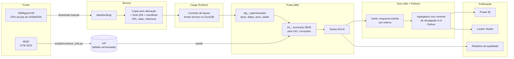
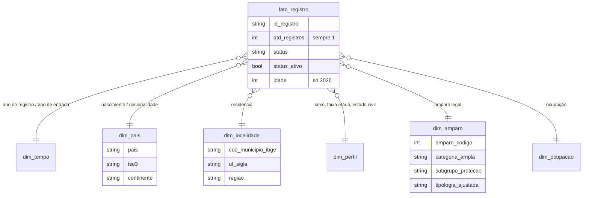
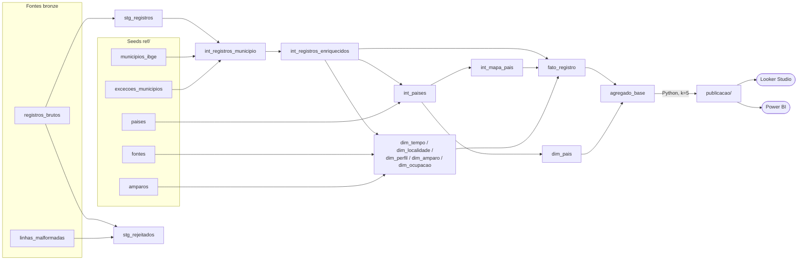

# sismigra-analytics

[Português](README.md) | **English**

[](https://github.com/agdala/sismigra-analytics/actions/workflows/tests.yml)
[](https://agdala.github.io/sismigra-analytics/)

Python, dbt and DuckDB pipeline that turns the public SISMIGRA microdata into a tested analytical base and protected aggregates for dashboards.

**Model documentation (dbt docs):** <https://agdala.github.io/sismigra-analytics/>

**1,361,391 records** from **SISMIGRA** (Sistema de Registro Nacional Migratório, Brazil's National
Migration Registry System), from 2021 to 2026, organized in layers (bronze in Python, silver and
gold in dbt), with tested data governance and data quality, a star schema and protected aggregates
for Power BI and Looker Studio.

> [!IMPORTANT]
> **2026 is a partial year (January to September).** The files only carry the registration year,
> with no month, so 2026 cannot be compared with the same period of previous years.
> **Dashboards filter on `ano_completo = true`** in every volume comparison (2021 to 2025).
> 2026 only appears in composition analyses (percentages), always labelled as partial.

> [!WARNING]
> **Publication rule:** any published dashboard or file (Power BI `.pbix`, Looker Studio, CSV,
> image) must use **only the protected aggregates in the [`publicacao/`](publicacao/) folder**,
> the official source for dashboards. The full star schema of the gold layer is for internal use
> only and must not be published. See [section 6](#6-disclosure-control).

---

## 1. Problem

SISMIGRA is the main source on the registered migrant population in Brazil, but the public files
are not ready for analysis:

- they carry no municipality code (IBGE) or country code (ISO), only names, with varying spellings;
- the layout changes between years (in 2026 the age band was replaced by exact age);
- there are invalid values (entry year `####`, age -1974) and several spellings for "not reported";
- the largest humanitarian group, solicitantes de refúgio (asylum seekers, amparo (legal basis for
  residence) 290), appears in the source as "NÃO APLICÁVEL" (not applicable) and disappears from any
  analysis by typology;
- about 60% of the rows are identical, which leads to mistaken deduplication.

This project turns these files into a reliable, traceable base that is comparable across years.

## 2. Analysis questions

1. How did the number of records evolve from 2021 to 2025, by amparo category?
2. What is the weight of **international and humanitarian protection** and of each subgroup
   (asylum seekers, recognized refugees, reception of Venezuelans, acolhida humanitária
   (humanitarian reception)) over time?
3. Which nationalities predominate and how does the composition of flows change?
4. Where do registered people live: concentration in Roraima and distribution across the other states?
5. What is the profile by sex and age band in each amparo category?
6. How much time passes between entry into Brazil and registration?
7. What is the quality of the information per year (missing, unspecified, corrections)?

**First figures (gold):**

| Year | Records | International and humanitarian protection |
|---|---|---|
| 2021 | 168,321 | 75.2% |
| 2022 | 243,675 | 69.6% |
| 2023 | 232,193 | 63.4% |
| 2024 | 248,167 | 61.3% |
| 2025 | 265,523 | 58.1% |
| 2026 (Jan-Sep, **partial**) | 203,512 | 52.6% |

_2026 is excluded from volume comparisons: the year has 9 months and the data has no month to trim the other years._

## 3. Architecture



_Diagram labels are kept in Portuguese, as in the code. Fonte = source; Carga = load; Prata = silver;
Ouro = gold; Publicação = publication; esquema estrela = star schema; controle de divulgação =
disclosure control; tabelas versionadas = versioned tables._

### Dimensional model (gold)



**Grain of the fact table:** 1 row = 1 migration record. The source is not aggregated; `qtd_registros` is 1.

## 4. How to run

### 4.1 Download the data

The files are public and stored in OBMigra/UnB folders on SharePoint. The site offers the files
for download, so this step is manual (the links are in [`ref/fontes.csv`](ref/fontes.csv)):

1. Download the ZIP for each year.
2. Put them, **without unzipping**, in the project's `data/landing/` folder.

### 4.2 On Windows, with Visual Studio Code

1. Install **Python 3.10 or later** (Microsoft Store, "Python 3.12") and the **Python** extension
   in VS Code (`Ctrl+Shift+X`, search for "Python").
2. Clone the repository: in VS Code, `Ctrl+Shift+P`, type **Git: Clone** and paste
   `https://github.com/agdala/sismigra-analytics`.
3. Open the terminal (**Terminal > New Terminal**) and run, one command at a time:

```bash
python -m venv .venv
```

```bash
.venv\Scripts\Activate.ps1
```

```bash
pip install -r requirements.txt
```

```bash
python -m sismigra.pipeline
```

> If activation fails with "running scripts is disabled", run
> `Set-ExecutionPolicy -Scope CurrentUser -ExecutionPolicy RemoteSigned` once and try again.
> If `python -m sismigra.pipeline` says "No module named sismigra", first run
> `pip install -e .` (installs the project in development mode).

### 4.3 On Linux or macOS

```bash
python3 -m venv .venv && source .venv/bin/activate
```

```bash
pip install -r requirements.txt && pip install -e .
```

```bash
make run
```

### 4.4 Outputs

| Path | Content |
|---|---|
| `data/bronze/manifest.json` | Provenance and hash of each file |
| `data/sismigra.duckdb` | DuckDB database with the bronze sources and all dbt models (staging, intermediate, marts, ref) |
| `data/gold/parquet/*.parquet` | Full star schema (**internal use**, do not publish) |
| `data/gold/csv/*.csv` | The same in CSV (`;`, UTF-8 with BOM, opens in Excel) |
| `publicacao/agregado_looker_nacionalidade.csv` | Year × country × profile × amparo, with disclosure control (about 10.6 thousand rows, 1.4 MB). **Versioned** |
| `publicacao/agregado_looker_territorio.csv` | Year × state × profile × amparo, with disclosure control (about 9.8 thousand rows, 1.3 MB). **Versioned** |
| `publicacao/metadados.json` | Generation date, hashes of the source files and result of the disclosure control. **Versioned** |
| `reports/qualidade/relatorio_qualidade.md` | Quality report of the latest run |

### 4.5 Tests

```bash
pytest
```

The tests use **synthetic data** generated on the fly, in the real layout. That is why they run on
GitHub Actions without the microdata.

## 5. Governance and quality

| Item | Where |
|---|---|
| Data dictionary (definition, origin and rule of each field) | [`docs/dicionario_de_dados.md`](docs/dicionario_de_dados.md) |
| Data protection note | [`docs/protecao_de_dados.md`](docs/protecao_de_dados.md) |
| Inventory of the actual columns (Stage 0) | [`reports/inventario/inventario.md`](reports/inventario/inventario.md) |
| Compatibility across years | [`docs/revisao/etapa0_compatibilidade.md`](docs/revisao/etapa0_compatibilidade.md) |
| Review of the 90 amparos, with rationale | [`docs/revisao/amparos_revisao.csv`](docs/revisao/amparos_revisao.csv) |
| Quality report (example from the latest run) | [`reports/qualidade/relatorio_qualidade.md`](reports/qualidade/relatorio_qualidade.md) |
| Validation rules | [`src/sismigra/quality.py`](src/sismigra/quality.py) and [`tests/`](tests/) |

**Rules**, declared only once in `quality.py` and covered by tests:

- **Rejection (R00 to R03):** malformed row, registration year missing or different from the file's year, amparo missing.
- **Flagged correction (C01 to C09):** invalid entry year, missing state, municipality matched by
  manual exception, sex, age band and invalid age, marital status and classification.
- **Disclosure control (k = 5):** in the Looker Studio aggregates, no published cell has 1 to 4
  records. Details in [section 6](#6-disclosure-control).
- **Alert (A01 to A06):** exact duplicates, municipality with no IBGE match, country or amparo
  with no reference, "MENOR" (minor) aged 25 or over, amparo with more than one legal provision in
  the same year.

**Contracts that make the pipeline fail instead of erring silently:**

- a file with a new or missing column stops the load (`ErroContrato`);
- a dbt test with error severity stops the pipeline (`ErroDbt`);
- a file that is not in `ref/fontes.csv` is not processed;
- an amparo without a category, or a country without a code, shows up as an alert, and the reference test fails.

## 6. Disclosure control

The microdata do not identify people, but a cell with few records (for example, a rare
nationality in a small state, in one year, by sex and age band) may allow re-identification.
That is why **no published cell has 1 to 4 records** (threshold k = 5).

**Why not simple suppression:** deleting the small cells from the original aggregate would hide
**7.3% of the records** (about 99 thousand) and distort the totals: Portugal, Italy and Germany
would lose about a third of their records, and Espírito Santo, 41%.

**Method adopted, in two phases** ([`src/sismigra/divulgacao.py`](src/sismigra/divulgacao.py)):

1. **Progressive grouping:** in cells with fewer than 5 records, the lowest-priority attributes
   are replaced by "Agrupado" (grouped), in steps, and the cells are summed again. Order:
   typology, subgroup, profile (sex, age band, status), category and, last, the country
   ("Outros países (continente)", other countries by continent).
2. **Residual suppression:** whatever is still below 5 gets an empty `qtd_registros` and
   `suprimido = true`. This includes **secondary suppression**: since the README publishes the
   exact total of each year, no year can be left with a single suppressed cell (its value could be
   recovered by subtraction). When that happens, the smallest published cell of the same year is
   also suppressed.

In addition, country and state are kept in **separate tables**, to avoid producing the sparsest cross-tabulation.

| Method | Records published | Largest loss (countries or states with 5 thousand records or more) |
|---|---|---|
| Simple suppression (single aggregate) | 92.7% | 33.5% for countries (Portugal) and 41.4% for states (ES) |
| **Adopted: nationality aggregate** | **99.998%** | **0.21%** |
| **Adopted: territory aggregate** | **99.981%** | **0.20%** |

**Cost:** about 1.5% (nationality) and 0.8% (territory) of the records end up in rows with some
"Agrupado" attribute. Each row carries `nivel_agrupamento` (0 = unchanged), and the quality report
shows the result of each step. Tests ensure that no published cell has 1 to 4 records and that
published + suppressed = total of the fact table.

**Publication rule:** published dashboards and files use only the two protected aggregates. The
full star schema is for internal use (validation and local exploration) and must not be published.

## 7. dbt layer

The silver and gold layers are **dbt** models (dbt-core with the dbt-duckdb adapter), in the same
DuckDB file as the pipeline. Python remains responsible for what is not transformation: download
and hash (bronze), layout contract and source loading, export and disclosure control.

**Browsable documentation (models, columns, tests and lineage):** <https://agdala.github.io/sismigra-analytics/>
(generated in CI from synthetic data, with no real data at all).

### 7.1 Model structure

| Layer | Schema | Materialization | Models | Role |
|---|---|---|---|---|
| Sources | `bronze` | tables (Python) | `registros_brutos`, `linhas_malformadas`, `manifesto` | Original CSVs as text, with provenance; `freshness` on the `ingerido_em` field |
| Seeds | `ref` | tables | `amparos`, `paises`, `municipios_ibge`, `excecoes_municipios`, `uf`, `fontes` | Reference tables from `ref/` |
| Staging | `staging` | view | `stg_registros`, `stg_rejeitados` | Types, dates, missing values, sex, age and age band; rejections R00 to R03 |
| Intermediate | `intermediate` | view / table | `int_registros_municipio`, `int_registros_enriquecidos`, `int_paises`, `int_mapa_pais` | IBGE municipality, ISO country, list of corrections (equivalent to the former silver layer) |
| Marts | `marts` | table | `fato_registro`, `dim_tempo`, `dim_pais`, `dim_localidade`, `dim_perfil`, `dim_amparo`, `dim_ocupacao`, `amparo_descricao_ano`, `agregado_base` | Star schema and basis for the disclosure control |
| Exposures | | | `painel_looker_studio`, `painel_power_bi` | Dashboards that depend only on the protected aggregates |

### 7.2 Lineage



### 7.3 dbt tests

- **Generic (dbt-core):** `not_null`, `unique`, `relationships` (the 8 keys of the fact table
  against the dimensions, municipalities against the DTB, countries against the map) and
  `accepted_values` (sex, age band, amparo category and subgroup, region, coverage...).
- **Custom generic tests** (`dbt/macros/testes/`): `expressao_verdadeira` and `sem_linhas`, with no
  dbt Hub packages.
- **Singular tests** (`dbt/tests/`), one per quality rule: reconciliation read = accepted +
  rejected, entry year up to the registration year, age band consistent with age, IBGE code in the
  right state, one name per ISO code, country and amparo with a reference (A03, A04), fact = sum of
  the aggregate and consistency of `ano_completo`.
- **Alerts** with `severity: warn` (non-blocking): A02 municipality with no IBGE match, A05 "MENOR"
  aged 25 or over and A06 amparo with more than one legal provision in the year.
- Result with the real data: **140 tests pass and 3 alerts** (the same as in the quality report).

### 7.4 Equivalence with the previous pipeline

Migrating from plain SQL to dbt did not change any result. The row-by-row comparison of the 13
tables, of the totals by year, country and state, and of the CSVs in `publicacao/` (byte by byte)
is in [`docs/revisao/equivalencia_dbt.md`](docs/revisao/equivalencia_dbt.md), generated by
`scripts/comparar_equivalencia.py`.

### 7.5 How to run

The single command is still the same and already runs `dbt build`:

```bash
python -m sismigra.pipeline
```

Standalone dbt commands, with the database already loaded (`data/sismigra.duckdb`):

```bash
make dbt-build
```

```bash
make dbt-docs
```

`make dbt-docs` generates the site with synthetic data in `dbt/target/static_index.html`. To use
dbt directly, run it from the `dbt/` folder, with `SISMIGRA_DUCKDB` pointing to the database and the
seeds copied from `ref/` to `dbt/seeds/` (`src/sismigra/dbt_runner.py` does this automatically).

## 8. Technical decisions

| Decision | Rationale |
|---|---|
| **DuckDB** | Processes 1.36 million rows in about 25 seconds on a laptop, with no server. |
| **dbt for the transformations** | Layered models (`stg_`, `int_`, marts), declarative tests, documentation and lineage generated from the code itself. The migration from plain SQL was validated with row-by-row equivalence. |
| **Python for bronze, load and disclosure** | Download, hash and layout contract must fail before any transformation; disclosure control is an iterative algorithm, clearer in Python than in SQL. |
| **No dbt Hub packages** | CI and tests run without network access. The tests that would come from external packages were written as custom generic tests. |
| **Seeds inside the dbt project** | `ref/` is the single source; the pipeline copies the CSVs to `dbt/seeds/` (outside Git). With the `../ref` path, dbt wrote the compiled SQL over the original CSVs; a test prevents this from coming back. |
| **Manual ingestion with hash** | The OBMigra site offers the files for download, with no direct access API. The SHA-256 in the manifest proves which version of each file was used. |
| **Duplicates kept** | With no personal identifier, identical rows are different people. Evidence: in 2026, with exact age, the duplicate rate drops from about 60% to 35%. |
| **2026 age band derived from age** | Keeps the series comparable, with the same cut-offs as the source. Exact age is available for 2026. |
| **Municipalities by normalized name + exceptions** | The source has no code. 99.99% of the reported municipalities match the DTB; the 7 remaining cases are in `ref/excecoes_municipios.csv`, each with a rationale. |
| **Countries by ISO, with a manual table** | 211 of 262 spellings match the ISO names in Portuguese automatically; 51 are mapped by hand, with a rationale for each case without an ISO code. |
| **Amparo hierarchy reviewed by a specialist** | The source typology hides asylum seekers and classifies CPLP mobility (326/327) as humanitarian reception. The review is traceable, line by line. |
| **Versioned reference tables** | IBGE data and business reviews are kept in `ref/`, reproducible without internet access. `scripts/construir_refs.py` regenerates them. |
| **CSV with BOM and `;`** | Opens directly in Excel in Portuguese without breaking accented characters. |
| **Disclosure control with grouping before suppression** | Deleting the cells with fewer than 5 records would hide 7.3% of the records and distort the totals (loss of a third for countries such as Portugal and of 41% in Espírito Santo). The method first groups the lowest-priority attributes (typology, subgroup, profile, category and, last, the country) and only suppresses what is still small. Result: 99.98% or more of the records published, and less than 0.3% loss in the totals of countries and states with 5 thousand records or more. |
| **Two aggregates instead of one** | Crossing country and state in the same table produces thousands of small cells. Separating nationality and territory reduces the re-identification risk and the suppressed volume. |

## 9. Data limitations

- **2026 is partial and there is no month:** a monthly series is not possible, nor comparing
  January to September 2026 with the same period of 2025. Compare volumes only between 2021 and
  2025 and use 2026 in composition analyses (percentages). The `ano_completo` field (in `dim_tempo`
  and in both aggregates) applies this filter, and **dashboards apply it by default**.
- **Looker aggregates with "Agrupado" rows:** about 1.5% of the records (nationality) and 0.8%
  (territory) are in rows where some attribute was replaced by "Agrupado". Totals by year, country
  and state remain correct, but a chart by sex or age band shows this share as "Agrupado". Analyses
  without this restriction can only be done locally on the star schema, and the result cannot be
  published without going through the same disclosure control.
- **Records, not people:** one person may have more than one record over the years (e.g. an
  asylum seeker later recognized as a refugee). The totals are of records issued.
- **Grounds for refugee status:** SISMIGRA does not report whether recognition was due to
  persecution or to serious and generalized violation of human rights (Lei 9.474/1997 (Brazil's
  Refugee Act), art. 1, III). Code 287 groups all recognized refugees.
- **"International and humanitarian protection" category:** combines refugee recognition, asylum
  applications and residence permits on humanitarian reception grounds (Lei 13.445/2017 (Brazil's
  Migration Law)). The subgroups are kept separate so that the total is not read as "refugees".
- **Missing values:** about 10% with no municipality specified, about 12% with no valid entry
  year and about 12% with no age band (17% with no age in 2026).
- **DTB 2023 and years 2021 to 2026:** no municipalities were created in the period, but the
  reference is from a single year.
- **Secondary source:** the files come from OBMigra/UnB, not directly from the Federal Police. The
  hashes in the manifest document the version used.

## 10. Dashboards

**Official source for dashboards: the [`publicacao/`](publicacao/) folder.** It contains the two
protected aggregates, versioned in the repository, and the [`LEIAME`](publicacao/LEIAME.md)
(README, in Portuguese) with the type, an example and the description of each column. It is the
only folder with data in Git.

**Rules common to both dashboards:**

1. **Source:** only `publicacao/agregado_looker_nacionalidade.csv` and
   `publicacao/agregado_looker_territorio.csv`. Never the star schema of the gold layer.
2. **Period:** volume comparisons use the filter `ano_completo = true` (2021 to 2025). 2026 only
   appears in percentages, labelled "2026 (jan-set, parcial)" (Jan-Sep, partial).
3. **Two separate sources:** do not join the two tables into one, because the totals would be counted twice.

### Power BI

> Placeholder. Import the two files from `publicacao/` as **two independent tables**, with no
> relationship between them (Get data > Text/CSV, comma separator). Use the measure
> `Registros = SUM(tabela[qtd_registros])` and the filter `ano_completo = true` in volume visuals.
> The published `.pbix` must not contain any full gold-layer table.

<!-- Dashboard screenshot to be added when published: docs/img/powerbi_visao_geral.png -->

**Link:** _to be published_

### Looker Studio

> Placeholder. Import `publicacao/agregado_looker_nacionalidade.csv` and
> `publicacao/agregado_looker_territorio.csv` as two data sources (file upload or Google Sheets)
> and create the filter `ano_completo = true` in volume charts. Use `SUM(qtd_registros)`:
> suppressed cells have an empty count and are ignored in the sum.

<!-- Dashboard screenshot to be added when published: docs/img/looker_visao_geral.png -->

**Link:** _to be published_

## 11. Repository structure

```
sismigra-analytics/
├── src/sismigra/       # bronze, load, dbt_runner, export, disclosure, quality, pipeline
├── dbt/                # dbt project: models/ (staging, intermediate, marts), macros/, tests/
├── ref/                # versioned reference tables (amparos, countries, municipalities, states, sources)
├── scripts/            # etapa0_inventario.py, construir_refs.py
├── tests/              # pytest with synthetic data
├── docs/               # dictionary, data protection, reviews, dashboard images
├── reports/            # inventory (Stage 0) and quality report
├── data/               # local, outside Git (landing, bronze, gold, sismigra.duckdb)
└── .github/workflows/  # tests (pytest + dbt build) and dbt docs publication
```

## 12. Sources

- SISMIGRA microdata: Federal Police, distributed by
  OBMigra/UnB ([Portal de Imigração](https://portaldeimigracao.mj.gov.br)).
- Brazilian Territorial Division (DTB 2023): [IBGE](https://www.ibge.gov.br/explica/codigos-dos-municipios.php).
- Country codes: ISO 3166-1, via [pycountry](https://pypi.org/project/pycountry/).

## Related projects

The four repositories form a data cycle, from collection to monitoring:

| Stage | Project | What it does | Published |
|---|---|---|---|
| 1. Collect | [xlsform-validator](https://github.com/agdala/xlsform-validator) | Quality, consent and LGPD (Brazil's General Data Protection Law) checks for KoboToolbox/ODK forms | [web version](https://agdala.github.io/xlsform-validator/) |
| 2. Transform and publish | **sismigra-analytics** (this repository) | Bronze/silver/gold pipeline with Python, DuckDB and dbt, with disclosure control | [dbt docs](https://agdala.github.io/sismigra-analytics/) |
| 3. Integrate | [record-linkage-kit](https://github.com/agdala/record-linkage-kit) | Deduplication and linkage of registries, with human review and pseudonymization | [report](https://agdala.github.io/record-linkage-kit/) |
| 4. Monitor | [monitoring-5w-kit](https://github.com/agdala/monitoring-5w-kit) | Partner reports, targets and double counting | [report](https://agdala.github.io/monitoring-5w-kit/) |

Author: Agda Santos, with the assistance of AI tools.

## License

MIT. See [LICENSE](LICENSE).
