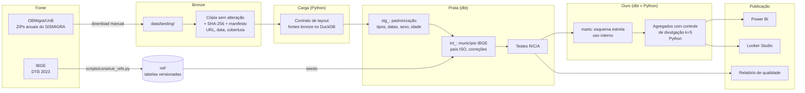
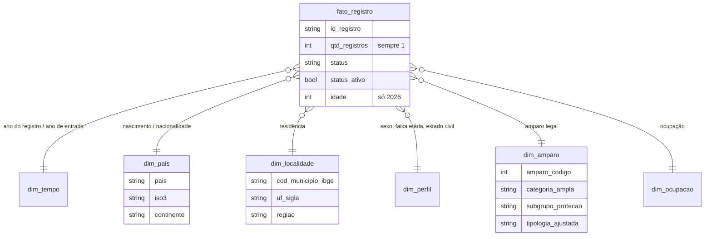
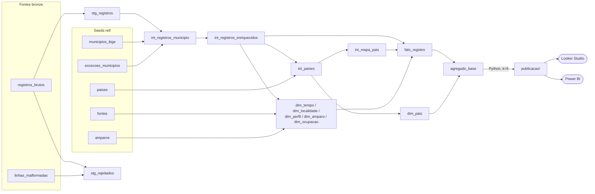

# sismigra-analytics

[](https://github.com/agdala/sismigra-analytics/actions/workflows/tests.yml)
[](https://agdala.github.io/sismigra-analytics/)

Pipeline em **Python + dbt + DuckDB** sobre os microdados públicos do **SISMIGRA** (Sistema de
Registro Nacional Migratório), de 2021 a 2026. São **1.361.391 registros** organizados em camadas
(bronze em Python, prata e ouro em dbt), com governança e qualidade de dados testadas, um esquema
estrela e agregados protegidos para Power BI e Looker Studio.

**Documentação dos modelos (dbt docs):** <https://agdala.github.io/sismigra-analytics/>

> [!IMPORTANT]
> **2026 é um ano parcial (janeiro a setembro).** Os arquivos trazem só o ano do registro, sem mês,
> então não é possível comparar 2026 com o mesmo período de anos anteriores.
> **Os painéis filtram por `ano_completo = true`** em todas as comparações de volume (2021 a 2025).
> 2026 aparece apenas em análises de composição (percentuais), sempre identificado como parcial.

> [!WARNING]
> **Regra de publicação:** qualquer painel ou arquivo publicado (Power BI `.pbix`, Looker Studio,
> CSV, imagem) deve usar **apenas os agregados protegidos da pasta [`publicacao/`](publicacao/)**,
> a fonte oficial dos painéis. O esquema estrela completo da camada ouro é só para uso interno
> e não pode ser publicado. Ver a [seção 6](#6-controle-de-divulgação).

---

## 1. Problema

O SISMIGRA é a principal fonte sobre a população migrante registrada no Brasil, mas os arquivos
públicos não estão prontos para análise:

- não trazem código de município (IBGE) nem de país (ISO), só nomes, com grafias variadas;
- o layout muda entre anos (em 2026 a faixa etária foi substituída pela idade exata);
- há valores inválidos (ano de entrada `####`, idade -1974) e várias grafias para "não informado";
- o maior grupo humanitário, os solicitantes de refúgio (amparo 290), aparece na fonte como
  "NÃO APLICÁVEL" e desaparece de qualquer análise por tipologia;
- cerca de 60% das linhas são idênticas, o que leva a uma deduplicação equivocada.

Este projeto transforma esses arquivos em uma base confiável, rastreável e comparável entre anos.

## 2. Perguntas de análise

1. Como evoluiu o número de registros de 2021 a 2025, por categoria de amparo?
2. Qual o peso da **proteção internacional e humanitária** e de cada subgrupo (solicitantes de
   refúgio, refugiados reconhecidos, acolhida de venezuelanos, acolhida humanitária) ao longo do tempo?
3. Quais nacionalidades predominam e como muda a composição dos fluxos?
4. Onde residem as pessoas registradas: concentração em Roraima e distribuição pelas demais UFs?
5. Qual o perfil por sexo e faixa etária em cada categoria de amparo?
6. Quanto tempo se passa entre a entrada no Brasil e o registro?
7. Qual a qualidade da informação por ano (ausentes, não especificados, correções)?

**Primeiros números (ouro):**

| Ano | Registros | Proteção internacional e humanitária |
|---|---|---|
| 2021 | 168.321 | 75,2% |
| 2022 | 243.675 | 69,6% |
| 2023 | 232.193 | 63,4% |
| 2024 | 248.167 | 61,3% |
| 2025 | 265.523 | 58,1% |
| 2026 (jan-set, **parcial**) | 203.512 | 52,6% |

_2026 não entra nas comparações de volume: o ano tem 9 meses e não há mês nos dados para recortar os demais anos._

## 3. Arquitetura



### Modelo dimensional (ouro)



**Grão do fato:** 1 linha = 1 registro migratório. A fonte não é agregada; `qtd_registros` vale 1.

## 4. Como rodar

### 4.1 Baixar os dados

Os arquivos são públicos e ficam em pastas do OBMigra/UnB no SharePoint. O site disponibiliza os
arquivos para download, então essa etapa é manual (os links estão em [`ref/fontes.csv`](ref/fontes.csv)):

1. Baixe os ZIPs de cada ano.
2. Coloque-os, **sem descompactar**, na pasta `data/landing/` do projeto.

### 4.2 No Windows, com o Visual Studio Code

1. Instale o **Python 3.10 ou superior** (Microsoft Store, "Python 3.12") e a extensão **Python**
   no VS Code (`Ctrl+Shift+X`, busque "Python").
2. Clone o repositório: no VS Code, `Ctrl+Shift+P`, digite **Git: Clone** e cole
   `https://github.com/agdala/sismigra-analytics`.
3. Abra o terminal (**Terminal > Novo Terminal**) e rode, um comando por vez:

```bash
python -m venv .venv
```

```bash
.venv\Scripts\Activate.ps1
```

```bash
pip install -r requirements.txt
```

```bash
python -m sismigra.pipeline
```

> Se a ativação der erro de "execução de scripts desabilitada", rode uma vez
> `Set-ExecutionPolicy -Scope CurrentUser -ExecutionPolicy RemoteSigned` e repita.
> Se `python -m sismigra.pipeline` disser "No module named sismigra", rode antes
> `pip install -e .` (instala o projeto em modo de desenvolvimento).

### 4.3 No Linux ou macOS

```bash
python3 -m venv .venv && source .venv/bin/activate
```

```bash
pip install -r requirements.txt && pip install -e .
```

```bash
make run
```

### 4.4 Saídas

| Caminho | Conteúdo |
|---|---|
| `data/bronze/manifest.json` | Procedência e hash de cada arquivo |
| `data/sismigra.duckdb` | Banco DuckDB com as fontes bronze e todos os modelos do dbt (staging, intermediate, marts, ref) |
| `data/gold/parquet/*.parquet` | Esquema estrela completo (**uso interno**, não publicar) |
| `data/gold/csv/*.csv` | O mesmo em CSV (`;`, UTF-8 com BOM, abre no Excel) |
| `publicacao/agregado_looker_nacionalidade.csv` | Ano × país × perfil × amparo, com controle de divulgação (cerca de 10,6 mil linhas, 1,4 MB). **Versionado** |
| `publicacao/agregado_looker_territorio.csv` | Ano × UF × perfil × amparo, com controle de divulgação (cerca de 9,8 mil linhas, 1,3 MB). **Versionado** |
| `publicacao/metadados.json` | Data de geração, hashes dos arquivos de origem e resultado do controle de divulgação. **Versionado** |
| `reports/qualidade/relatorio_qualidade.md` | Relatório de qualidade da última execução |

### 4.5 Testes

```bash
pytest
```

Os testes usam **dados sintéticos** gerados na hora, no layout real. Por isso rodam no GitHub
Actions sem os microdados.

## 5. Governança e qualidade

| Item | Onde |
|---|---|
| Dicionário de dados (definição, origem e regra de cada campo) | [`docs/dicionario_de_dados.md`](docs/dicionario_de_dados.md) |
| Nota de proteção de dados | [`docs/protecao_de_dados.md`](docs/protecao_de_dados.md) |
| Inventário das colunas reais (Etapa 0) | [`reports/inventario/inventario.md`](reports/inventario/inventario.md) |
| Compatibilidade entre anos | [`docs/revisao/etapa0_compatibilidade.md`](docs/revisao/etapa0_compatibilidade.md) |
| Revisão dos 90 amparos, com justificativa | [`docs/revisao/amparos_revisao.csv`](docs/revisao/amparos_revisao.csv) |
| Relatório de qualidade (exemplo da última execução) | [`reports/qualidade/relatorio_qualidade.md`](reports/qualidade/relatorio_qualidade.md) |
| Regras de validação | [`src/sismigra/quality.py`](src/sismigra/quality.py) e [`tests/`](tests/) |

**Regras**, declaradas uma única vez em `quality.py` e cobertas por testes:

- **Rejeição (R00 a R03):** linha malformada, ano do registro ausente ou diferente do ano do arquivo, amparo ausente.
- **Correção com marcação (C01 a C09):** ano de entrada inválido, UF ausente, município por exceção
  manual, sexo, faixa etária e idade inválida, estado civil e classificação.
- **Controle de divulgação (k = 5):** nos agregados do Looker Studio, nenhuma célula publicada tem
  de 1 a 4 registros. Detalhes na [seção 6](#6-controle-de-divulgação).
- **Alerta (A01 a A06):** duplicatas exatas, município sem correspondência no IBGE, país ou amparo
  sem referência, "MENOR" com 25 anos ou mais, amparo com mais de uma norma no mesmo ano.

**Contratos que fazem o pipeline falhar em vez de errar em silêncio:**

- um arquivo com coluna nova ou faltando interrompe a carga (`ErroContrato`);
- um teste do dbt com severidade de erro interrompe o pipeline (`ErroDbt`);
- um arquivo que não está em `ref/fontes.csv` não é processado;
- um amparo sem categoria, ou um país sem código, aparece como alerta, e o teste de referência falha.

## 6. Controle de divulgação

Os microdados não identificam pessoas, mas uma célula com poucos registros (por exemplo, uma
nacionalidade rara numa UF pequena, num ano, por sexo e faixa etária) pode permitir a
reidentificação. Por isso **nenhuma célula publicada tem de 1 a 4 registros** (limiar k = 5).

**Por que não a supressão simples:** apagar as células pequenas do agregado original esconderia
**7,3% dos registros** (cerca de 99 mil) e distorceria os totais: Portugal, Itália e Alemanha
perderiam cerca de um terço dos registros, e o Espírito Santo, 41%.

**Método adotado, em duas fases** ([`src/sismigra/divulgacao.py`](src/sismigra/divulgacao.py)):

1. **Agrupamento progressivo:** nas células com menos de 5 registros, os atributos de menor
   prioridade são trocados por "Agrupado", em etapas, e as células são somadas de novo. Ordem:
   tipologia, subgrupo, perfil (sexo, faixa etária, status), categoria e, por último, o país
   ("Outros países (continente)").
2. **Supressão residual:** o que continuar abaixo de 5 fica com `qtd_registros` vazio e
   `suprimido = true`. Inclui uma **supressão secundária**: como o README publica o total exato de
   cada ano, nenhum ano pode ficar com uma única célula suprimida (o valor sairia por subtração).
   Quando isso acontece, a menor célula publicada do mesmo ano também é suprimida.

Além disso, país e UF ficam em **tabelas separadas**, para não gerar o cruzamento mais esparso.

| Método | Registros publicados | Maior perda (países ou UFs com 5 mil registros ou mais) |
|---|---|---|
| Supressão simples (agregado único) | 92,7% | 33,5% nos países (Portugal) e 41,4% nas UFs (ES) |
| **Adotado: agregado por nacionalidade** | **99,998%** | **0,21%** |
| **Adotado: agregado por território** | **99,981%** | **0,20%** |

**Custo:** cerca de 1,5% (nacionalidade) e 0,8% (território) dos registros ficam em linhas com algum
atributo "Agrupado". Cada linha traz `nivel_agrupamento` (0 = sem alteração), e o relatório de
qualidade mostra o resultado de cada etapa. Testes garantem que nenhuma célula publicada tem de 1
a 4 registros e que publicado + suprimido = total do fato.

**Regra de publicação:** painéis e arquivos publicados usam só os dois agregados protegidos. O
esquema estrela completo é para uso interno (validação e exploração local) e não pode ser publicado.

## 7. Camada dbt

As camadas prata e ouro são modelos **dbt** (dbt-core com o adaptador dbt-duckdb), no mesmo
arquivo DuckDB do pipeline. O Python continua responsável pelo que não é transformação: download
e hash (bronze), contrato de layout e carga das fontes, exportação e controle de divulgação.

**Documentação navegável (modelos, colunas, testes e linhagem):** <https://agdala.github.io/sismigra-analytics/>
(gerada no CI a partir de dados sintéticos, sem nenhum dado real).

### 7.1 Estrutura dos modelos

| Camada | Schema | Materialização | Modelos | Papel |
|---|---|---|---|---|
| Fontes | `bronze` | tabelas (Python) | `registros_brutos`, `linhas_malformadas`, `manifesto` | CSVs originais como texto, com procedência; `freshness` pelo campo `ingerido_em` |
| Seeds | `ref` | tabelas | `amparos`, `paises`, `municipios_ibge`, `excecoes_municipios`, `uf`, `fontes` | Tabelas de referência de `ref/` |
| Staging | `staging` | view | `stg_registros`, `stg_rejeitados` | Tipos, datas, ausentes, sexo, idade e faixa etária; rejeições R00 a R03 |
| Intermediate | `intermediate` | view / tabela | `int_registros_municipio`, `int_registros_enriquecidos`, `int_paises`, `int_mapa_pais` | Município IBGE, país ISO, lista de correções (equivale à antiga prata) |
| Marts | `marts` | tabela | `fato_registro`, `dim_tempo`, `dim_pais`, `dim_localidade`, `dim_perfil`, `dim_amparo`, `dim_ocupacao`, `amparo_descricao_ano`, `agregado_base` | Esquema estrela e base do controle de divulgação |
| Exposures | | | `painel_looker_studio`, `painel_power_bi` | Painéis que dependem só dos agregados protegidos |

### 7.2 Linhagem



### 7.3 Testes do dbt

- **Genéricos (dbt-core):** `not_null`, `unique`, `relationships` (as 8 chaves do fato com as
  dimensões, municípios com a DTB, países com o mapa) e `accepted_values` (sexo, faixa etária,
  categoria e subgrupo de amparo, região, cobertura...).
- **Genéricos próprios** (`dbt/macros/testes/`): `expressao_verdadeira` e `sem_linhas`, sem pacotes
  do dbt Hub.
- **Singulares** (`dbt/tests/`), um por regra de qualidade: reconciliação lidas = aceitas +
  rejeitadas, ano de entrada até o ano do registro, faixa coerente com a idade, código IBGE na UF
  certa, um nome por código ISO, país e amparo com referência (A03, A04), fato = soma do agregado e
  coerência de `ano_completo`.
- **Alertas** com `severity: warn` (não bloqueiam): A02 município sem correspondência no IBGE,
  A05 "MENOR" com 25 anos ou mais e A06 amparo com mais de uma norma no ano.
- Resultado com os dados reais: **140 testes passam e 3 alertas** (os mesmos do relatório de qualidade).

### 7.4 Equivalência com o pipeline anterior

A migração do SQL puro para o dbt não mudou nenhum resultado. A comparação linha a linha das 13
tabelas, dos totais por ano, país e UF e dos CSVs de `publicacao/` (byte a byte) está em
[`docs/revisao/equivalencia_dbt.md`](docs/revisao/equivalencia_dbt.md), gerada por
`scripts/comparar_equivalencia.py`.

### 7.5 Como rodar

O comando único continua o mesmo e já roda o `dbt build`:

```bash
python -m sismigra.pipeline
```

Comandos do dbt isolados, com o banco já carregado (`data/sismigra.duckdb`):

```bash
make dbt-build
```

```bash
make dbt-docs
```

O `make dbt-docs` gera o site com dados sintéticos em `dbt/target/static_index.html`. Para usar o
dbt diretamente, rode a partir da pasta `dbt/`, com `SISMIGRA_DUCKDB` apontando para o banco e as
seeds copiadas de `ref/` para `dbt/seeds/` (o `src/sismigra/dbt_runner.py` faz isso sozinho).

## 8. Decisões técnicas

| Decisão | Motivo |
|---|---|
| **DuckDB** | Processa 1,36 milhão de linhas em cerca de 25 segundos num notebook, sem servidor. |
| **dbt para as transformações** | Modelos em camadas (`stg_`, `int_`, marts), testes declarativos, documentação e linhagem geradas do próprio código. A migração do SQL puro foi validada com equivalência linha a linha. |
| **Python para bronze, carga e divulgação** | Download, hash e contrato de layout precisam falhar antes de qualquer transformação; o controle de divulgação é um algoritmo iterativo, mais claro em Python do que em SQL. |
| **Sem pacotes do dbt Hub** | O CI e os testes rodam sem rede. Os testes que viriam de pacotes externos foram escritos como testes genéricos próprios. |
| **Seeds dentro do projeto dbt** | `ref/` é a fonte única; o pipeline copia os CSVs para `dbt/seeds/` (fora do Git). Com o caminho `../ref`, o dbt gravava o SQL compilado por cima dos CSVs originais; um teste impede que isso volte. |
| **Ingestão manual com hash** | O site do OBMigra disponibiliza os arquivos para download, sem uma API de acesso direto. O SHA-256 no manifesto prova qual versão de cada arquivo foi usada. |
| **Duplicatas mantidas** | Sem identificador pessoal, linhas iguais são pessoas diferentes. Prova: em 2026, com idade exata, a taxa de duplicatas cai de cerca de 60% para 35%. |
| **Faixa etária de 2026 derivada da idade** | Mantém a série comparável, com os mesmos cortes da fonte. A idade exata fica disponível para 2026. |
| **Municípios por nome normalizado + exceções** | A fonte não tem código. 99,99% dos municípios informados casam com a DTB; os 7 casos restantes estão em `ref/excecoes_municipios.csv`, cada um com justificativa. |
| **Países por ISO, com tabela manual** | 211 de 262 grafias casam automaticamente com os nomes ISO em português; 51 são mapeadas à mão, com justificativa para cada caso sem código ISO. |
| **Hierarquia de amparo revisada por especialista** | A tipologia da fonte esconde os solicitantes de refúgio e classifica a mobilidade CPLP (326/327) como acolhida humanitária. A revisão é rastreável, linha a linha. |
| **Tabelas de referência versionadas** | O IBGE e as revisões de negócio ficam em `ref/`, reprodutíveis sem acesso à internet. `scripts/construir_refs.py` as regenera. |
| **CSV com BOM e `;`** | Abre direto no Excel em português sem quebrar os acentos. |
| **Controle de divulgação com agrupamento antes da supressão** | Apagar as células com menos de 5 registros esconderia 7,3% dos registros e distorceria os totais (perda de um terço em países como Portugal e de 41% no Espírito Santo). O método agrupa primeiro os atributos de menor prioridade (tipologia, subgrupo, perfil, categoria e, por último, o país) e só suprime o que continuar pequeno. Resultado: 99,98% ou mais dos registros publicados, e menos de 0,3% de perda nos totais de países e UFs com 5 mil registros ou mais. |
| **Dois agregados em vez de um** | Cruzar país e UF na mesma tabela gera milhares de células pequenas. Separar nacionalidade e território reduz o risco de reidentificação e o volume suprimido. |

## 9. Limitações dos dados

- **2026 é parcial e não há mês:** não dá para fazer série mensal nem comparar janeiro a setembro
  de 2026 com o mesmo período de 2025. Compare volumes só entre 2021 e 2025 e use 2026 em análises
  de composição (percentuais). O campo `ano_completo` (na `dim_tempo` e nos dois agregados) faz esse
  filtro, e **os painéis o aplicam por padrão**.
- **Agregados do Looker com linhas "Agrupado":** cerca de 1,5% dos registros (nacionalidade) e 0,8%
  (território) estão em linhas em que algum atributo foi trocado por "Agrupado". Os totais por ano,
  país e UF ficam corretos, mas um gráfico por sexo ou faixa etária mostra essa parcela como
  "Agrupado". Análises sem essa restrição só podem ser feitas localmente sobre o esquema estrela,
  e o resultado não pode ser publicado sem passar pelo mesmo controle de divulgação.
- **Registros, não pessoas:** uma pessoa pode ter mais de um registro ao longo dos anos (ex.:
  solicitante que depois é reconhecido como refugiado). Os totais são de registros emitidos.
- **Fundamento do refúgio:** o SISMIGRA não informa se o reconhecimento foi por perseguição ou por
  grave e generalizada violação de direitos humanos (Lei 9.474/1997, art. 1º, III). O código 287
  reúne todos os refugiados reconhecidos.
- **Categoria "Proteção internacional e humanitária":** junta reconhecimento de refúgio, solicitação
  de refúgio e autorizações de residência por acolhida (Lei 13.445/2017). Os subgrupos ficam
  separados para não ler o total como "refugiados".
- **Ausentes:** cerca de 10% sem município especificado, cerca de 12% sem ano de entrada válido e
  cerca de 12% sem faixa etária (17% sem idade em 2026).
- **DTB 2023 e anos 2021 a 2026:** não houve criação de municípios no período, mas a referência é
  de um único ano.
- **Fonte secundária:** os arquivos vêm do OBMigra/UnB, não diretamente da Polícia Federal. Os
  hashes no manifesto documentam a versão usada.

## 10. Painéis

**Fonte oficial dos painéis: a pasta [`publicacao/`](publicacao/).** Ela contém os dois agregados
protegidos, versionados no repositório, e o [`LEIAME`](publicacao/LEIAME.md) com o tipo, um exemplo e
a descrição de cada coluna. É a única pasta com dados no Git.

**Regras comuns aos dois painéis:**

1. **Fonte:** só `publicacao/agregado_looker_nacionalidade.csv` e
   `publicacao/agregado_looker_territorio.csv`. Nunca o esquema estrela da camada ouro.
2. **Período:** comparações de volume usam o filtro `ano_completo = true` (2021 a 2025). 2026 aparece
   só em percentuais, com o rótulo "2026 (jan-set, parcial)".
3. **Duas fontes separadas:** não junte as duas tabelas numa só, porque os totais seriam somados duas vezes.

### Power BI

> Espaço reservado. Importe os dois arquivos de `publicacao/` como **duas tabelas independentes**, sem
> relacionamento entre elas (Obter dados > Texto/CSV, separador vírgula). Use a medida
> `Registros = SUM(tabela[qtd_registros])` e o filtro `ano_completo = true` nos visuais de volume.
> O `.pbix` publicado não deve conter nenhuma tabela da camada ouro completa.


**Link:** _a publicar_

### Looker Studio

> Espaço reservado. Importe `publicacao/agregado_looker_nacionalidade.csv` e
> `publicacao/agregado_looker_territorio.csv` como duas fontes de dados (upload de arquivo ou
> Google Sheets) e crie o filtro `ano_completo = true` nos gráficos de volume. Use `SUM(qtd_registros)`:
> as células suprimidas têm contagem vazia e são ignoradas na soma.


**Link:** _a publicar_

## 11. Estrutura do repositório

```
sismigra-analytics/
├── src/sismigra/       # bronze, carga, dbt_runner, exportacao, divulgacao, quality, pipeline
├── dbt/                # projeto dbt: models/ (staging, intermediate, marts), macros/, tests/
├── ref/                # tabelas de referência versionadas (amparos, países, municípios, UFs, fontes)
├── scripts/            # etapa0_inventario.py, construir_refs.py
├── tests/              # pytest com dados sintéticos
├── docs/               # dicionário, proteção de dados, revisões, imagens dos painéis
├── reports/            # inventário (Etapa 0) e relatório de qualidade
├── data/               # local, fora do Git (landing, bronze, gold, sismigra.duckdb)
└── .github/workflows/  # testes (pytest + dbt build) e publicação do dbt docs
```

## 12. Fontes

- Microdados do SISMIGRA: Polícia Federal, distribuídos pelo
  OBMigra/UnB ([Portal de Imigração](https://portaldeimigracao.mj.gov.br)).
- Divisão Territorial Brasileira (DTB 2023): [IBGE](https://www.ibge.gov.br/explica/codigos-dos-municipios.php).
- Códigos de país: ISO 3166-1, via [pycountry](https://pypi.org/project/pycountry/).

## Licença

MIT. Veja [LICENSE](LICENSE).
