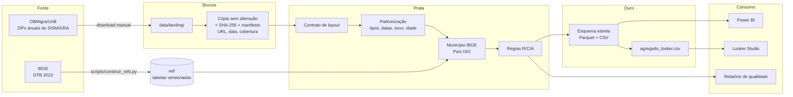
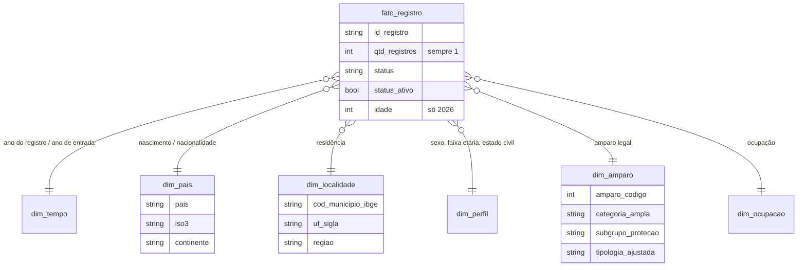

# sismigra-analytics

[](https://github.com/agdala/sismigra-analytics/actions/workflows/tests.yml)

Pipeline em **Python + DuckDB** sobre os microdados públicos do **SISMIGRA** (Sistema de Registro
Nacional Migratório), de 2021 a 2026. São **1.361.391 registros** organizados em camadas (bronze,
prata, ouro), com governança e qualidade de dados testadas e um esquema estrela pronto para
Power BI e Looker Studio.

---

## 1. Problema

O SISMIGRA é a principal fonte sobre a população migrante registrada no Brasil, mas os arquivos
públicos não estão prontos para análise:

- não trazem código de município (IBGE) nem de país (ISO), só nomes, com grafias variadas;
- o layout muda entre anos (em 2026 a faixa etária foi substituída pela idade exata);
- há valores inválidos (ano de entrada `####`, idade -1974) e várias grafias para "não informado";
- o maior grupo humanitário, os solicitantes de refúgio (amparo 290), aparece na fonte como
  "NÃO APLICÁVEL" e desaparece de qualquer análise por tipologia;
- cerca de 60% das linhas são idênticas, o que leva a uma deduplicação equivocada.

Este projeto transforma esses arquivos em uma base confiável, rastreável e comparável entre anos.

## 2. Perguntas de análise

1. Como evoluiu o número de registros de 2021 a 2025, por categoria de amparo?
2. Qual o peso da **proteção internacional e humanitária** e de cada subgrupo (solicitantes de
   refúgio, refugiados reconhecidos, acolhida de venezuelanos, acolhida humanitária) ao longo do tempo?
3. Quais nacionalidades predominam e como muda a composição dos fluxos?
4. Onde residem as pessoas registradas: concentração em Roraima e distribuição pelas demais UFs?
5. Qual o perfil por sexo e faixa etária em cada categoria de amparo?
6. Quanto tempo se passa entre a entrada no Brasil e o registro?
7. Qual a qualidade da informação por ano (ausentes, não especificados, correções)?

**Primeiros números (ouro):**

| Ano | Registros | Proteção internacional e humanitária |
|---|---|---|
| 2021 | 168.321 | 75,2% |
| 2022 | 243.675 | 69,6% |
| 2023 | 232.193 | 63,4% |
| 2024 | 248.167 | 61,3% |
| 2025 | 265.523 | 58,1% |
| 2026 (jan-set) | 203.512 | 52,6% |

## 3. Arquitetura



### Modelo dimensional (ouro)



**Grão do fato:** 1 linha = 1 registro migratório. A fonte não é agregada; `qtd_registros` vale 1.

## 4. Como rodar

### 4.1 Baixar os dados

Os arquivos ficam em pastas do OBMigra/UnB no SharePoint, que **exigem login institucional**. Por
isso o download é manual (os links estão em [`ref/fontes.csv`](ref/fontes.csv)):

1. Baixe os ZIPs de cada ano.
2. Coloque-os, **sem descompactar**, na pasta `data/landing/` do projeto.

### 4.2 No Windows, com o Visual Studio Code

1. Instale o **Python 3.10 ou superior** (Microsoft Store, "Python 3.12") e a extensão **Python**
   no VS Code (`Ctrl+Shift+X`, busque "Python").
2. Clone o repositório: no VS Code, `Ctrl+Shift+P`, digite **Git: Clone** e cole
   `https://github.com/agdala/sismigra-analytics`.
3. Abra o terminal (**Terminal > Novo Terminal**) e rode, um comando por vez:

```bash
python -m venv .venv
```

```bash
.venv\Scripts\Activate.ps1
```

```bash
pip install -r requirements.txt
```

```bash
python -m sismigra.pipeline
```

> Se a ativação der erro de "execução de scripts desabilitada", rode uma vez
> `Set-ExecutionPolicy -Scope CurrentUser -ExecutionPolicy RemoteSigned` e repita.
> Se `python -m sismigra.pipeline` disser "No module named sismigra", rode antes
> `pip install -e .` (instala o projeto em modo de desenvolvimento).

### 4.3 No Linux ou macOS

```bash
python3 -m venv .venv && source .venv/bin/activate
```

```bash
pip install -r requirements.txt && pip install -e .
```

```bash
make run
```

### 4.4 Saídas

| Caminho | Conteúdo |
|---|---|
| `data/bronze/manifest.json` | Procedência e hash de cada arquivo |
| `data/silver/registros.parquet` | Registros padronizados |
| `data/silver/rejeitados.parquet` | Registros rejeitados com o motivo |
| `data/gold/parquet/*.parquet` | Esquema estrela (para o Power BI) |
| `data/gold/csv/*.csv` | O mesmo em CSV (`;`, UTF-8 com BOM, abre no Excel) |
| `data/gold/agregado_looker.csv` | Tabela agregada (cerca de 82 mil linhas) para o Looker Studio |
| `reports/qualidade/relatorio_qualidade.md` | Relatório de qualidade da última execução |

### 4.5 Testes

```bash
pytest
```

Os testes usam **dados sintéticos** gerados na hora, no layout real. Por isso rodam no GitHub
Actions sem os microdados.

## 5. Governança e qualidade

| Item | Onde |
|---|---|
| Dicionário de dados (definição, origem e regra de cada campo) | [`docs/dicionario_de_dados.md`](docs/dicionario_de_dados.md) |
| Nota de proteção de dados | [`docs/protecao_de_dados.md`](docs/protecao_de_dados.md) |
| Inventário das colunas reais (Etapa 0) | [`reports/inventario/inventario.md`](reports/inventario/inventario.md) |
| Compatibilidade entre anos | [`docs/revisao/etapa0_compatibilidade.md`](docs/revisao/etapa0_compatibilidade.md) |
| Revisão dos 90 amparos, com justificativa | [`docs/revisao/amparos_revisao.csv`](docs/revisao/amparos_revisao.csv) |
| Relatório de qualidade (exemplo da última execução) | [`reports/qualidade/relatorio_qualidade.md`](reports/qualidade/relatorio_qualidade.md) |
| Regras de validação | [`src/sismigra/quality.py`](src/sismigra/quality.py) e [`tests/`](tests/) |

**Regras**, declaradas uma única vez em `quality.py` e cobertas por testes:

- **Rejeição (R00 a R03):** linha malformada, ano do registro ausente ou diferente do ano do arquivo, amparo ausente.
- **Correção com marcação (C01 a C09):** ano de entrada inválido, UF ausente, município por exceção
  manual, sexo, faixa etária e idade inválida, estado civil e classificação.
- **Alerta (A01 a A06):** duplicatas exatas, município sem correspondência no IBGE, país ou amparo
  sem referência, "MENOR" com 25 anos ou mais, amparo com mais de uma norma no mesmo ano.

**Contratos que fazem o pipeline falhar em vez de errar em silêncio:**

- um arquivo com coluna nova ou faltando interrompe a prata (`ErroContrato`);
- um arquivo que não está em `ref/fontes.csv` não é processado;
- um amparo sem categoria, ou um país sem código, aparece como alerta, e o teste de referência falha.

## 6. Decisões técnicas

| Decisão | Motivo |
|---|---|
| **DuckDB com SQL puro** | Processa 1,36 milhão de linhas em cerca de 17 segundos num notebook, sem servidor. O SQL fica versionado e legível (`sql/`). |
| **Ingestão manual com hash** | Os links do SharePoint exigem autenticação (testado: HTTP 401). O SHA-256 no manifesto prova qual versão de cada arquivo foi usada. |
| **Duplicatas mantidas** | Sem identificador pessoal, linhas iguais são pessoas diferentes. Prova: em 2026, com idade exata, a taxa de duplicatas cai de cerca de 60% para 35%. |
| **Faixa etária de 2026 derivada da idade** | Mantém a série comparável, com os mesmos cortes da fonte. A idade exata fica disponível para 2026. |
| **Municípios por nome normalizado + exceções** | A fonte não tem código. 99,99% dos municípios informados casam com a DTB; os 7 casos restantes estão em `ref/excecoes_municipios.csv`, cada um com justificativa. |
| **Países por ISO, com tabela manual** | 211 de 262 grafias casam automaticamente com os nomes ISO em português; 51 são mapeadas à mão, com justificativa para cada caso sem código ISO. |
| **Hierarquia de amparo revisada por especialista** | A tipologia da fonte esconde os solicitantes de refúgio e classifica a mobilidade CPLP (326/327) como acolhida humanitária. A revisão é rastreável, linha a linha. |
| **Tabelas de referência versionadas** | O IBGE e as revisões de negócio ficam em `ref/`, reprodutíveis sem acesso à internet. `scripts/construir_refs.py` as regenera. |
| **CSV com BOM e `;`** | Abre direto no Excel em português sem quebrar os acentos. |

## 7. Limitações dos dados

- **Só o ano, sem mês:** não dá para fazer série mensal nem comparar janeiro a setembro de 2026 com
  o mesmo período de 2025. **2026 é parcial**: compare volumes só entre 2021 e 2025 e use 2026 em
  análises de composição (percentuais). A `dim_tempo` traz `ano_completo` para filtrar.
- **Registros, não pessoas:** uma pessoa pode ter mais de um registro ao longo dos anos (ex.:
  solicitante que depois é reconhecido como refugiado). Os totais são de registros emitidos.
- **Fundamento do refúgio:** o SISMIGRA não informa se o reconhecimento foi por perseguição ou por
  grave e generalizada violação de direitos humanos (Lei 9.474/1997, art. 1º, III). O código 287
  reúne todos os refugiados reconhecidos.
- **Categoria "Proteção internacional e humanitária":** junta reconhecimento de refúgio, solicitação
  de refúgio e autorizações de residência por acolhida (Lei 13.445/2017). Os subgrupos ficam
  separados para não ler o total como "refugiados".
- **Ausentes:** cerca de 10% sem município especificado, cerca de 12% sem ano de entrada válido e
  cerca de 12% sem faixa etária (17% sem idade em 2026).
- **DTB 2023 e anos 2021 a 2026:** não houve criação de municípios no período, mas a referência é
  de um único ano.
- **Fonte secundária:** os arquivos vêm do OBMigra/UnB, não diretamente da Polícia Federal. Os
  hashes no manifesto documentam a versão usada.

## 8. Painéis

### Power BI

> Espaço reservado. Conecte o Power BI aos arquivos de `data/gold/parquet/`.


**Link:** _a publicar_

### Looker Studio

> Espaço reservado. Importe `data/gold/agregado_looker.csv` (Google Sheets ou upload de arquivo).


**Link:** _a publicar_

## 9. Estrutura do repositório

```
sismigra-analytics/
├── src/sismigra/       # bronze.py, silver.py, gold.py, quality.py, pipeline.py, config.py
├── sql/                # silver.sql e gold.sql (transformações DuckDB)
├── ref/                # tabelas de referência versionadas (amparos, países, municípios, UFs, fontes)
├── scripts/            # etapa0_inventario.py, construir_refs.py
├── tests/              # pytest com dados sintéticos
├── docs/               # dicionário, proteção de dados, revisões, imagens dos painéis
├── reports/            # inventário (Etapa 0) e relatório de qualidade
├── data/               # local, fora do Git (landing, bronze, silver, gold)
└── .github/workflows/  # CI com os testes
```

## 10. Fontes

- Microdados do SISMIGRA: Polícia Federal, distribuídos pelo
  OBMigra/UnB ([Portal de Imigração](https://portaldeimigracao.mj.gov.br)).
- Divisão Territorial Brasileira (DTB 2023): [IBGE](https://www.ibge.gov.br/explica/codigos-dos-municipios.php).
- Códigos de país: ISO 3166-1, via [pycountry](https://pypi.org/project/pycountry/).

## Licença

MIT. Veja [LICENSE](LICENSE).
